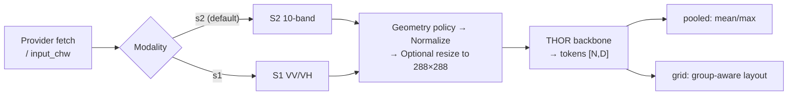
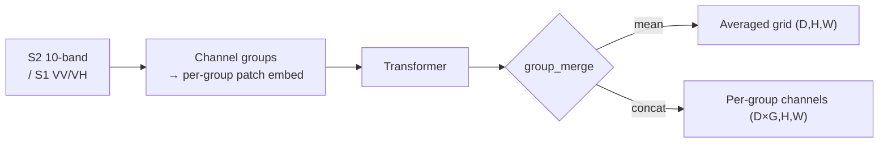
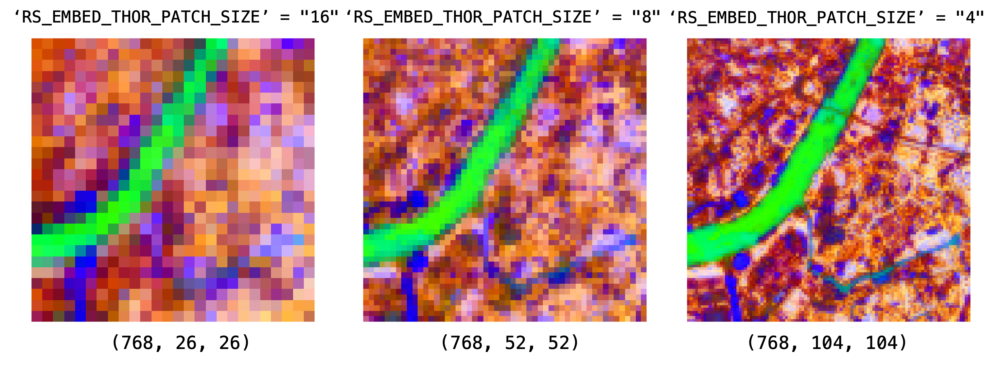

# THOR (`thor`)

## Quick Facts

| Field              | Value                                                                                             |
| ------------------ | ------------------------------------------------------------------------------------------------- |
| Model ID           | `thor`                                                                                            |
| Aliases            | `thor_1_0_base`                                                                                   |
| Family / Backbone  | Fully vendored THOR runtime (`thor_v1_tiny` / `thor_v1_small` / `thor_v1_base` / `thor_v1_large`) |
| Adapter type       | `on-the-fly`                                                                                      |
| Model config keys  | `variant` (default: `base`; choices: `tiny`, `small`, `base`, `large`)                            |
| Training alignment | High when `thor_stats` normalization and default S2 SR setup are preserved                        |

!!! success "THOR In 30 Seconds"
    THOR in `rs-embed` can run either a Sentinel-2 SR 10-band path or a Sentinel-1 VV/VH path, and it works well when you want either a pooled embedding or a grid-like token output while preserving THOR's channel-group structure.

    In `rs-embed`, its most important characteristics are:

    - grouped token layout instead of one ready-made spatial feature map: see [Output Semantics](#output-semantics)
    - patch-size-sensitive token density and geometry: see [Environment Variables / Tuning Knobs](#environment-variables-tuning-knobs)
    - bounded `native_snap` preprocessing for small near-square projection mismatches: see [Preprocessing Pipeline](#preprocessing-pipeline)

---

## Quick Decision Guide

=== "Near-Square Input"

    Use `input_prep="resize"` with the default `RS_EMBED_THOR_RESIZE_MODE=native_snap`.

    This handles small projection mismatches without forcing an immediate `288x288` resize.

=== "Large ROI"

    Use `input_prep="tile"`.

    This avoids token explosion and keeps stitched grid geometry stable.

=== "Per-Group Channels"

    Use `RS_EMBED_THOR_GROUP_MERGE=concat`.

    This keeps aligned group maps separate in the channel dimension instead of collapsing them into one shared grid.

!!! warning "What Usually Goes Wrong"
    Most THOR confusion comes from three places: changing `patch_size` without checking that `image_size` still divides cleanly, assuming `native_snap` should also apply inside tiled inference, and interpreting `concat` grids as directly comparable to `mean` grids. Treat those as different representation settings, not just cosmetic options.

---

## Input Contract

Provider-only backend (`gee` / `auto`). `TemporalSpec` is normalized to a range via the shared helper; `TemporalSpec.range(...)` is recommended for reproducibility — the temporal window controls compositing rather than locking to one acquisition. Side inputs: none.

| Modality       | Collection                    | Bands (order)                                | `input_chw`                        | Default normalization              | Extra fetch fields                                                        |
| -------------- | ----------------------------- | -------------------------------------------- | ---------------------------------- | ---------------------------------- | ------------------------------------------------------------------------- |
| `s2` (default) | `COPERNICUS/S2_SR_HARMONIZED` | `B2,B3,B4,B5,B6,B7,B8,B8A,B11,B12` (10-band) | `CHW`, `C=10`, raw SR `0..10000`   | `thor_stats` z-score after `/10000` | `scale_m=10`, `cloudy_pct=30`, `composite="median"`, `fill_value=0.0`     |
| `s1`           | `COPERNICUS/S1_GRD_FLOAT`     | `VV, VH` (2-band)                            | `CHW`, `C=2` in `VV,VH`, raw VV/VH | shared S1 `log1p` + p99 scaling    | `use_float_linear=True`, `s1_require_iw=True`, `s1_relax_iw_on_empty=True` |

Before normalization, the adapter clips NaN/Inf values and clamps raw SR to `0..10000`. Set `RS_EMBED_THOR_NORMALIZE=none` to bypass the default normalization on either modality.

---

## Preprocessing Pipeline



---

## Architecture Concept



---

## Environment Variables / Tuning Knobs

| Env var                           | Default        | Effect                                                                                          |
| --------------------------------- | -------------- | ----------------------------------------------------------------------------------------------- |
| `RS_EMBED_THOR_MODEL_KEY`         | `thor_v1_base` | THOR backbone key for the vendored runtime                                                      |
| `RS_EMBED_THOR_CKPT`              | unset          | Local checkpoint path override                                                                  |
| `RS_EMBED_THOR_PRETRAINED`        | `1`            | Use pretrained weights (HF default path)                                                        |
| `RS_EMBED_THOR_IMG`               | `288`          | Resize target image size                                                                        |
| `RS_EMBED_THOR_RESIZE_MODE`       | `native_snap`  | `native_snap` keeps bounded snapped native sides; `fixed` always resizes to `RS_EMBED_THOR_IMG` |
| `RS_EMBED_THOR_NORMALIZE`         | `thor_stats`   | S2: `thor_stats`, `unit_scale`, or `none`; S1: `thor_stats` (shared S1 log normalize) or `none` |
| `RS_EMBED_THOR_GROUP_MERGE`       | `mean`         | THOR group-grid aggregation: `mean`, `sum`, `concat`                                            |
| `RS_EMBED_THOR_PATCH_SIZE`        | `8`            | THOR flexi patch size parameter                                                                 |
| `RS_EMBED_THOR_SHAPE_ADJUST`      | `crop`         | Side `native_snap` snaps from for near-square inputs: `crop` (short side) or `pad` (long side)  |
| `RS_EMBED_THOR_SHAPE_TOL_PX`      | `8`            | Maximum `abs(H-W)` tolerated before `native_snap` falls back to fixed resize                    |
| `RS_EMBED_THOR_MAX_NATIVE_SIDE`   | `384`          | Snapped native side above which THOR falls back to fixed resize, if that lowers the token count |
| `RS_EMBED_THOR_MAX_NATIVE_TOKENS` | `3000`         | Patch-token count above which THOR falls back to fixed resize, if that lowers the count         |
| `RS_EMBED_THOR_FETCH_WORKERS`     | `8`            | Provider prefetch workers for batch APIs                                                        |

=== "Patch Size"

    `patch_size` changes token density, not embedding dimension. Smaller patch sizes mean denser token grids and more compute.

    Keep `RS_EMBED_THOR_IMG` divisible by `2 * RS_EMBED_THOR_PATCH_SIZE` for the current S2 10m/20m path. If you are unsure, keep `RS_EMBED_THOR_IMG=288` and change only `patch_size` to one of the known-compatible values such as `4`, `6`, `8`, `12`, `16`, or `18`.

=== "Resize vs Tile"

    `input_prep="resize"` means one whole input patch goes through THOR once; in that path the adapter may use `native_snap`.

    `input_prep="tile"` means the API slices a larger input into multiple tiles first; inside that tiled path THOR intentionally uses fixed per-tile resize behavior so the stitched output still maps cleanly back to the tile layout. An input that fits one tile is not tiled: it is passed whole, exactly as in `resize` mode.

=== "Native-Snap Limits"

    `native_snap` is intentionally bounded. An input that is not close to square always falls back to fixed resize. Past `RS_EMBED_THOR_MAX_NATIVE_SIDE` or `RS_EMBED_THOR_MAX_NATIVE_TOKENS`, THOR falls back only when that lowers the token count (see below), so an input below `RS_EMBED_THOR_IMG` can stay native past either limit.

    For the current default S2 10m/20m path with `patch_size=8`, `side=384` corresponds to about `2880` patch tokens, which is why `384` is the default ceiling.

    `native_snap` snaps to the nearest valid side (a multiple of 16 px at `patch_size=8` and 10 m; a tie pads up), starting from the short side under `shape_adjust=crop` or the long side under `pad`, and center-fits the input to it, padding by replicating edge pixels. A 1 px fetch overshoot (289 px for a 2880 m ROI) therefore crops back to 288 px, and no zero fill reaches the model. When the snapped side would break one of the limits above and the valid side one unit below meets them, that side is used instead if the breach would resample the input to `RS_EMBED_THOR_IMG`, or if the snap was a tie that padded up (e.g. 393–407 px run natively at 384 px instead of a 288 px resize).

    `meta["shape_prep"]["input_window"]` records where the input lies in the array fed to THOR, and the ROI crop is mapped through it. Grid output drops the ROI's context margin and any whole tokens of padding; `shape_prep.model_grid_hw` and `shape_prep.grid_crop_box` record the uncropped grid and the kept token box. Pooled output pools THOR's tokens inside the ROI window for every ROI (`pooling="roi_token_<mean|max>"` for an ROI sub-window), so pooled vectors have the same length, scale and group weighting whatever the ROI's shape.

    Each distinct native side has its own ground cover, and THOR builds one model per ground cover (up to 8 stay cached). THOR exports run point by point in input order, so ROIs that snap to many different sides rebuild the model often (about 0.6 s each for `base` with cached weights). Use ROIs of one size, e.g. a fixed `PointBuffer` radius, to keep a single model.

    Past either limit, THOR falls back to a fixed resize to `RS_EMBED_THOR_IMG`, but only when that resize actually lowers the token count, i.e. when `RS_EMBED_THOR_IMG` is smaller than the snapped side. The token count is set by ground cover / (`patch_size` × GSD), so a resize to a larger side would add tokens and misstate the geometry. In that case THOR runs the input natively, emits a `UserWarning` and records `meta["native_limit_exceeded"]`. With `patch_size=4`, for example, a 256 px input needs 5120 tokens and runs natively (the 288 px fallback would need 6480), while a 380 px input falls back to 288 px. Raise `RS_EMBED_THOR_MAX_NATIVE_TOKENS` to keep larger inputs native. Under `input_prep="resize"`, switching to `"tile"` also keeps inputs larger than one tile at native spacing.

!!! warning "Fixed resize changes the pixel spacing THOR assumes"
    THOR reads each band's GSD (10 m / 20 m) from its channel config and is told a ground cover of `scale_m × RS_EMBED_THOR_IMG`. Any fixed resize of an input whose side is not `RS_EMBED_THOR_IMG` therefore runs the model at the wrong scale. For example, a 256 px (2560 m) input stretched to 288 px is treated as 2880 m at 10 m, but the real spacing is 8.89 m, and patch-size embeddings and output grid cells are off by the same factor. THOR emits a `UserWarning` when this happens and records the real spacing in `meta["effective_gsd_m"]` (per axis, `(y, x)`) and `meta["gsd_mismatch"]`. `native_snap` never resamples, so its spacing stays exact.

## Model-specific Settings

`variant` selects the THOR backbone size. In `rs-embed`, pass it as `variant="tiny" | "small" | "base" | "large"`.

| Variant | Vendored model key | Parameters | Output channels | Transformer blocks | Attention heads | Notes                                     |
| ------- | ------------------ | ---------- | --------------- | ------------------ | --------------- | ----------------------------------------- |
| `tiny`  | `thor_v1_tiny`     | 7.6M       | 192             | 12                 | 3               | Smallest and fastest option.              |
| `small` | `thor_v1_small`    | 25.8M      | 384             | 12                 | 6               | Middle ground when `tiny` is too limited. |
| `base`  | `thor_v1_base`     | 94.1M      | 768             | 12                 | 12              | Current default.                          |
| `large` | `thor_v1_large`    | 314.4M     | 1024            | 24                 | 16              | Highest capacity and heaviest runtime.    |

!!! info "How To Read Output Channels"
    `Output channels` here means the default THOR embedding width for `pooled` output and for `grid` output when group aggregation keeps one shared channel space, such as `RS_EMBED_THOR_GROUP_MERGE=mean` or `sum`.

    If you use `RS_EMBED_THOR_GROUP_MERGE=concat`, the final `grid` channel count becomes `embedding_width x number_of_THOR_groups`, so it is larger than the values listed above.

Example:

```python
from rs_embed import PointBuffer, TemporalSpec, OutputSpec, get_embedding

emb = get_embedding(
    "thor",
    spatial=PointBuffer(lon=121.5, lat=31.2, buffer_m=2048),
    temporal=TemporalSpec.range("2022-06-01", "2022-09-01"),
    output=OutputSpec.pooled(),
    backend="gee",
    variant="large",
)
```

---

## Output Semantics

### `OutputSpec.pooled()`

`OutputSpec.pooled()` pools the token sequence through `_pool_thor_tokens(...)`. When the expected THOR patch-token count is available, the adapter uses it to avoid pooling non-patch tokens incorrectly. Metadata records the pooling mode and `cls_removed`.

### `OutputSpec.grid()`

`OutputSpec.grid()` first tries to build a THOR group-aware grid with `grid_kind="thor_group_grid"` from the channel groups. If that fails, it falls back to a generic ViT-style patch-token reshape with `grid_kind="patch_tokens"`. Some token layouts still cannot be reshaped into a grid, in which case the adapter raises a clear error and suggests using pooled output.

The group-aware path exists because native THOR emits one token sequence plus layout metadata, not one uniform spatial tensor. `rs-embed` uses that metadata to reconstruct per-group feature maps, upsamples lower-resolution groups onto the densest group grid, and then applies `group_merge`.

=== "`mean`"

    Use this unless you have a specific reason not to.

    It averages aligned group maps into one shared grid, keeps output dimensionality stable, and is the easiest setting to compare across runs.

=== "`sum`"

    Use this when you want one shared grid but prefer additive responses over averaging.

    It is more sensitive to feature scale than `mean`.

=== "`concat`"

    Use this only when downstream code expects a wider channel dimension and you explicitly want to preserve group-specific information instead of collapsing it.

---

## Examples

Minimal example:

```python
from rs_embed import get_embedding, PointBuffer, TemporalSpec, OutputSpec

emb = get_embedding(
    "thor",
    spatial=PointBuffer(lon=121.5, lat=31.2, buffer_m=2048),
    temporal=TemporalSpec.range("2022-06-01", "2022-09-01"),
    output=OutputSpec.pooled(),
    backend="gee",
)
```

=== "S1 Via Modality"

    ```python
    from rs_embed import get_embedding, PointBuffer, TemporalSpec, OutputSpec

    emb = get_embedding(
        "thor",
        spatial=PointBuffer(lon=121.5, lat=31.2, buffer_m=2048),
        temporal=TemporalSpec.range("2022-06-01", "2022-09-01"),
        modality="s1",
        output=OutputSpec.pooled(),
        backend="gee",
    )
    ```

    This switches THOR onto the default `VV,VH` Sentinel-1 path. If you need a different provider collection, pass an explicit `SensorSpec(..., modality="s1")`.
    

=== "Common Tuning"

    ```bash
    export RS_EMBED_THOR_RESIZE_MODE=native_snap
    export RS_EMBED_THOR_NORMALIZE=thor_stats
    export RS_EMBED_THOR_GROUP_MERGE=mean
    export RS_EMBED_THOR_IMG=288
    export RS_EMBED_THOR_PATCH_SIZE=8
    ```

=== "Native-Snap"

    ```bash
    export RS_EMBED_THOR_RESIZE_MODE=native_snap
    export RS_EMBED_THOR_SHAPE_ADJUST=crop
    export RS_EMBED_THOR_SHAPE_TOL_PX=8
    export RS_EMBED_THOR_MAX_NATIVE_SIDE=384
    export RS_EMBED_THOR_MAX_NATIVE_TOKENS=3000
    ```

    This lets THOR keep a snapped native side for near-square inputs such as `289x288` or `300x300`, but still falls back to fixed resize for larger or more expensive inputs when that resize lowers the token count.

=== "Patch Size"

    ```bash
    export RS_EMBED_THOR_IMG=288
    export RS_EMBED_THOR_PATCH_SIZE=4
    ```

    Use a smaller `patch_size` when spatial detail matters more than runtime or memory. At `patch_size=4`, inputs above about 196 px exceed the default `3000`-token limit: those under 288 px run natively with a warning, larger ones fall back to a 288 px resize. Raise `RS_EMBED_THOR_MAX_NATIVE_TOKENS` (for example to `12000`) to keep them all native.

    ```bash
    export RS_EMBED_THOR_IMG=288
    export RS_EMBED_THOR_PATCH_SIZE=12
    ```

    Use a larger `patch_size` when you want a coarser token grid with lower compute cost.

    ```bash
    export RS_EMBED_THOR_IMG=280
    export RS_EMBED_THOR_PATCH_SIZE=10
    ```

    When `patch_size` no longer divides cleanly, change `RS_EMBED_THOR_IMG` together with it.

    

=== "Large ROI / Tile"

    ```python
    from rs_embed import get_embedding, PointBuffer, TemporalSpec, OutputSpec, InputPrepSpec

    emb = get_embedding(
        "thor",
        spatial=PointBuffer(lon=121.5, lat=31.2, buffer_m=4096),
        temporal=TemporalSpec.range("2022-06-01", "2022-09-01"),
        output=OutputSpec.grid(pooling="mean"),
        backend="gee",
        input_prep=InputPrepSpec.tile(tile_size=288),
    )
    ```

    In this mode the large input is split into `288x288` tiles. Each tile uses THOR's fixed per-tile resize path rather than `native_snap`, so stitched grid outputs stay aligned with the tile layout.

=== "Variant"

    ```python
    from rs_embed import get_embedding, PointBuffer, TemporalSpec, OutputSpec

    emb = get_embedding(
        "thor",
        spatial=PointBuffer(lon=121.5, lat=31.2, buffer_m=2048),
        temporal=TemporalSpec.range("2022-06-01", "2022-09-01"),
        output=OutputSpec.grid(pooling="mean"),
        backend="gee",
        variant="small",
    )
    ```

    Use `variant` only for backbone size selection. Other THOR runtime knobs such as image size, normalization, patch size, and checkpoint override still use the environment-variable path above.

---

## Paper & Links

- **Publication**: [arXiv 2026](https://arxiv.org/abs/2601.16011)
- **Code**: [FM4CS/THOR](https://github.com/FM4CS/THOR)

---

## Reference

- Changing `patch_size` without updating `image_size` to divide cleanly is the most common misconfiguration.
- Inside tiled inference, THOR uses fixed per-tile resize instead of `native_snap`. This only applies to inputs that are actually split into tiles: an input that fits one tile is passed to THOR whole, as a plain call, so `native_snap` applies to it. The default tile size follows `RS_EMBED_THOR_IMG`; if you set `tile_size` explicitly, keep it equal to `RS_EMBED_THOR_IMG` and keep `pad_edges=True`, or each tile is resampled and THOR runs at the wrong pixel spacing.
- A fixed resize that changes the pixel spacing emits a `UserWarning`; check `meta["gsd_mismatch"]` and `meta["effective_gsd_m"]` on exported embeddings. For tiled inputs, the shared tiler may also have shrunk an axis by up to `tile_snap_frac` (10% by default) to avoid near-duplicate edge tiles; that is recorded separately in `meta["input_prep"]["snapped_from_hw"]`.
- `group_merge=concat` and `group_merge=mean` produce different channel dimensions; do not compare them directly.
- Grid construction can fail if the token layout is not square and group parsing cannot resolve it — fall back to `pooled` to isolate the issue.
